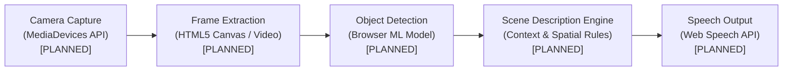

# DigitalVision Architecture

> [!NOTE]
> **Status:** Stage 1 Foundation & Architecture Planning  
> **Notice:** All AI detection, camera capture, text-to-speech, and OCR capabilities mentioned herein are **PLANNED** and **NOT IMPLEMENTED**.

---

## 1. Project Purpose

**DigitalVision** is an AI-powered environmental awareness and navigation assistant designed for individuals who are blind or visually impaired. The application acts as a real-time assistive companion, transforming visual cues from a device camera into spoken descriptions and directional guidance.

Key user goals:
- **Obstacle Awareness:** Identify immediate hazards and obstacles in walking paths.
- **Scene & Object Description:** Understand prominent items in the environment (e.g., doors, chairs, signs, people).
- **Accessible Navigation:** Receive concise, real-time audio feedback with zero complex setup.
- **Dignity & Independence:** Operate reliably without sending private visual feeds to third-party cloud servers.

---

## 2. High-Level Architecture

DigitalVision is built as a **client-only Single-Page Application (SPA)** that runs entirely within modern web browsers.

```
+---------------------------------------------------------------------------------+
|                               User's Web Browser                                |
|                                                                                 |
|  +---------------------------------------------------------------------------+  |
|  |                       React UI Layer (Vite + JavaScript)                  |  |
|  |   - Accessible UI Controls                                                |  |
|  |   - Camera Preview & Status Feedbacks                                     |  |
|  |   - High-contrast Plain CSS Theme                                         |  |
|  +-------------------------------------+-------------------------------------+  |
|                                        |                                        |
|                                        v                                        |
|  +---------------------------------------------------------------------------+  |
|  |                       Services Layer (Planned)                            |  |
|  |                                                                           |  |
|  |   +-------------------+  +-------------------+  +---------------------+   |  |
|  |   |   cameraService   |  | detectionService  |  |    speechService    |   |  |
|  |   | [NOT IMPLEMENTED] |  | [NOT IMPLEMENTED] |  |  [NOT IMPLEMENTED]  |   |  |
|  |   +---------+---------+  +---------+---------+  +----------+----------+   |  |
|  +-------------|----------------------|-----------------------|--------------+  |
|                v                      v                       v                 |
|  +---------------------------------------------------------------------------+  |
|  |                             Browser APIs                                  |  |
|  |   - navigator.mediaDevices (Camera)                                       |  |
|  |   - WebGL / WebAssembly (Client-side Pretrained ML Inference)             |  |
|  |   - window.speechSynthesis (Web Speech API)                               |  |
|  +---------------------------------------------------------------------------+  |
+---------------------------------------------------------------------------------+
|                               NO BACKEND SERVER                                 |
|                          NO EXTERNAL DATABASE / AUTH                            |
|                             NO PAID THIRD-PARTY APIS                            |
+---------------------------------------------------------------------------------+
```

### Architectural Principles: Why Client-Only?

The project intentionally avoids a backend server, database, authentication system, or paid third-party APIs:

1. **Hackathon Simplicity:** A client-only architecture removes the overhead of backend deployment, database migrations, server maintenance, and container orchestration. The team can focus 100% on assistive user experience.
2. **Absolute User Privacy:** Visually impaired users must trust assistive technology with visual streams of their personal environments (homes, workplaces, private spaces). By keeping camera feeds and inference entirely within the local browser memory, no personal video or audio leaves the user's device.
3. **Zero Operational Costs:** With no cloud servers, compute clusters, or paid API endpoints, DigitalVision has zero hosting billing and can be deployed freely to static hosting platforms (such as GitHub Pages or Vercel).
4. **Zero API Key Management:** Eliminating cloud AI services avoids managing secret credentials, securing environment variables in client bundles, or running into rate limits and bill shocks during demonstrations.

---

## 3. Planned Data Flow [STATUS: PLANNED - NOT IMPLEMENTED]

The runtime data pipeline is designed as a unidirectional flow from the physical environment to spoken audio:



### Pipeline Stages

1. **Camera Frame Capture (`cameraService` — PLANNED):**  
   Accesses the device video stream using `navigator.mediaDevices.getUserMedia` with user permission. Renders to a hidden or preview video element.
2. **Object Detection (`detectionService` — PLANNED):**  
   Captures video frames at a throttled interval and feeds pixel data to a browser-based, client-side pretrained machine learning model running on WebGL/WebAssembly. Produces identified labels, confidence scores, and bounding coordinates.
3. **Description Generation (PLANNED):**  
   Translates raw detection coordinates into natural language descriptions (e.g., *"Chair directly ahead, approximately 2 meters away"*, *"Door on your left"*). Filters repetitive detections to prevent audio clutter.
4. **Speech Output (`speechService` — PLANNED):**  
   Feeds the generated natural language text into the browser's native `window.speechSynthesis` API, generating immediate, audible feedback.

---

## 4. Directory & Folder Responsibilities

The codebase follows a modular structure under `frontend/` and `docs/`:

| Directory | Primary Responsibility | Current Status |
| :--- | :--- | :--- |
| `frontend/src/components/` | Reusable UI components (buttons, accessible indicators, navigation controls, status cards) | In progress |
| `frontend/src/pages/` | Page-level view components (e.g., main camera interface, settings/help view) | In progress |
| `frontend/src/services/` | Encapsulated modules for hardware and browser APIs (`cameraService`, `detectionService`, `speechService`, `ocrService`) | **PLANNED** (Not Implemented) |
| `frontend/src/styles/` | Global styles, typography, high-contrast themes, and accessible styling utilities | In progress |
| `docs/` | System architecture, API contracts, team standards, and developer setup documentation | Active |

---

## 5. Decisions Already Made

The team has committed to the following foundational technical choices:

- **React + Vite + JavaScript:**  
  Provides instantaneous Hot Module Replacement (HMR), straightforward component composition, and broad compatibility without TypeScript compilation overhead during rapid hackathon prototyping.
- **Plain CSS:**  
  Uses standard, vanilla CSS for predictable styling, zero extra runtime dependencies, and direct control over high-contrast styling and WCAG accessibility standards.
- **Browser-Based Detection:**  
  All object detection will use free, open-source pretrained models loaded client-side via WebGL/WASM. No external inference APIs.
- **Web Speech API for TTS:**  
  Native browser speech synthesis (`window.speechSynthesis`) is used for text-to-speech output. It requires zero libraries, works offline, and costs nothing.
- **No Backend / No DB / No Auth:**  
  The system remains strictly static and local to the user's browser session.

---

## 6. Open Decisions for Later Stages

The following technical and architectural decisions are pending evaluation during later stages:

| Decision Item | Options Under Consideration | Key Trade-offs / Considerations |
| :--- | :--- | :--- |
| **Pretrained Model Selection** | TensorFlow.js (COCO-SSD, MobileNet) vs. MediaPipe vs. ONNX Runtime Web | Model download size vs. inference latency on mobile devices vs. detection accuracy. |
| **Detection Frequency & Throttling** | Continuous loop (10-30 fps) vs. Throttled polling (1-2 fps) vs. On-demand trigger | CPU/GPU load, device overheating, battery life on mobile browsers, and responsiveness. |
| **Spoken Description Formatting** | Minimal priority-only alerts vs. Full sentences vs. Directional clock-face format | Preventing audio overwhelm for users while conveying safety-critical spatial context. |
| **Error Recovery Strategy** | Silent fallback vs. Auditory tones vs. Clear spoken error announcements | Handling camera permission denials, camera occlusion, or unsupported browser APIs. |
| **OCR Integration Approach** | In-browser Tesseract.js vs. Web-native TextDetector API (where supported) | Bundle size impact (Tesseract traineddata) vs. browser support fragmentation. |

---

## 7. Implementation Status Tracker

| Subsystem | Planned Technology | Implementation Status |
| :--- | :--- | :--- |
| **Application Shell & UI** | React, Vite, Plain CSS | 🟡 In Progress (Stage 1) |
| **Camera Feed Capture** | `navigator.mediaDevices.getUserMedia` | 🔴 **PLANNED (NOT IMPLEMENTED)** |
| **Object Detection Engine** | Browser-based pretrained model | 🔴 **PLANNED (NOT IMPLEMENTED)** |
| **Speech Output (TTS)** | Native Web Speech API | 🔴 **PLANNED (NOT IMPLEMENTED)** |
| **Text Recognition (OCR)** | Client-side OCR library | 🔴 **PLANNED (NOT IMPLEMENTED)** |
| **Data Storage / Backend** | None (Client-only) | 🟢 Intentionally Omitted |
